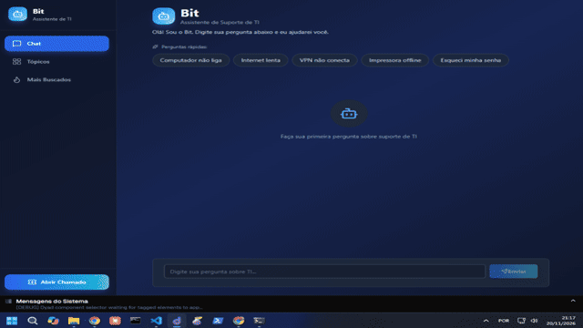
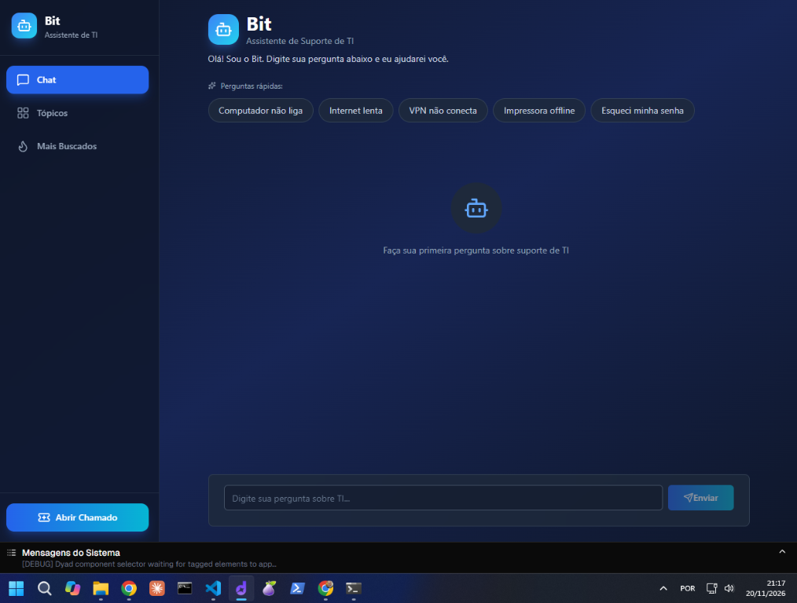

# Bit - Assistente de Suporte de TI

> Projeto de assistencia tecnica baseado em RAG, com uma interface conversacional para encontrar orientacoes em uma base de conhecimento sobre suporte de TI.

## Visao geral

O Bit permite que o usuario descreva problemas de forma natural e receba orientacoes relacionadas aos documentos da base de conhecimento. A interface foi pensada para ser direta, organizada e adequada a ambientes corporativos de suporte.

## Interface em destaque

<table>
  <tr>
    <td width="68%">
      
    </td>
    <td width="32%">
      <strong>Experiencia principal</strong>
      <ul>
        <li>Menu lateral de navegacao</li>
        <li>Conversas por chat</li>
        <li>Perguntas rapidas sugeridas</li>
        <li>Indicacao visual de processamento</li>
        <li>Campo de envio acessivel</li>
      </ul>
    </td>
  </tr>
</table>

## Principais areas da interface

### Navegacao lateral

O menu organiza as principais acoes: Chat, Topicos, Mais Buscados e abertura de chamado.

### Cabecalho e atalhos

O cabecalho apresenta o nome do assistente e inclui perguntas frequentes para iniciar uma conversa rapidamente.

### Envio de mensagens

O usuario pode digitar a duvida no campo inferior e enviar a pergunta com o botao de envio.

## Fluxo de uso

## Capacidades demonstradas

- Interface responsiva em React e TypeScript
- Conversa em linguagem natural
- Sugestoes de perguntas frequentes
- Recuperacao de informacoes com embeddings
- Respostas fundamentadas em documentos corporativos
- Indicacao das fontes consultadas
- Integracao entre frontend e API Python

## Tecnologias

**Frontend:** React, TypeScript, Vite, Tailwind CSS e Radix UI  
**Backend:** Python, FastAPI, Uvicorn e Pydantic  
**IA e dados:** ChromaDB, Sentence Transformers e OpenRouter

Consulte [TECNOLOGIAS.md](./TECNOLOGIAS.md) para a documentacao completa das tecnologias.
