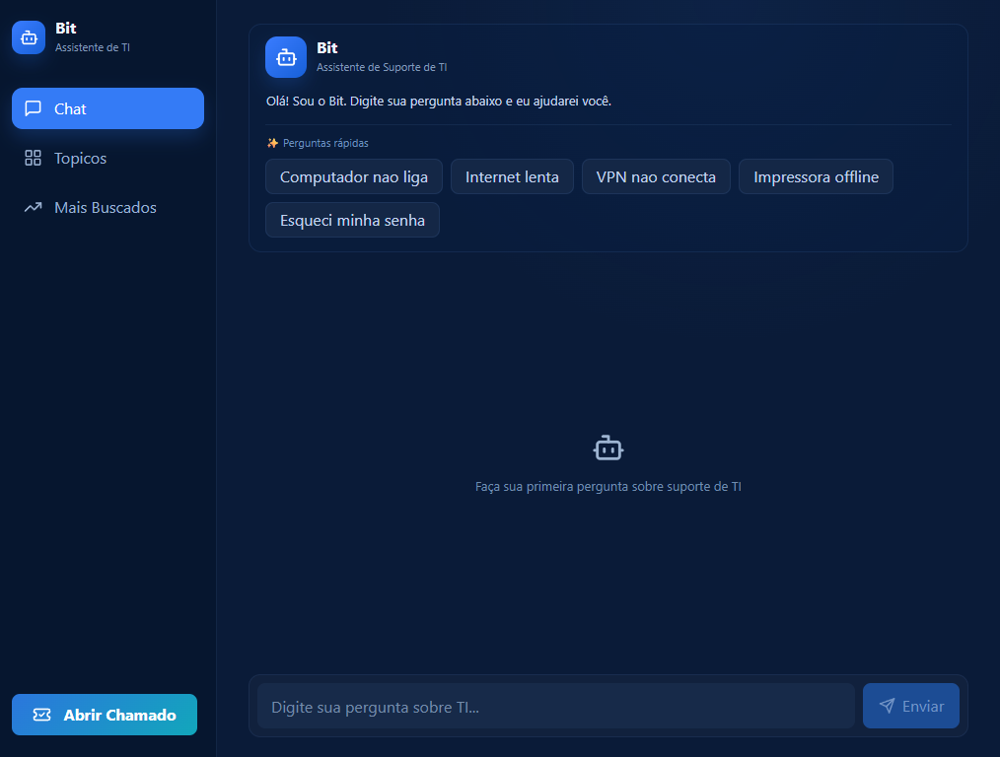
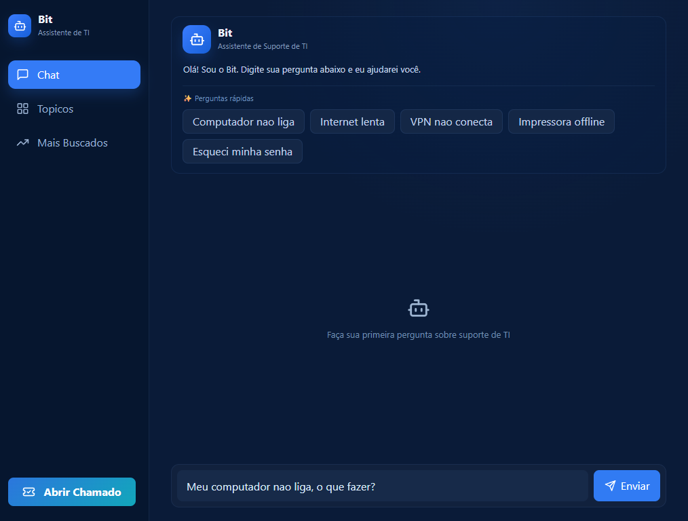
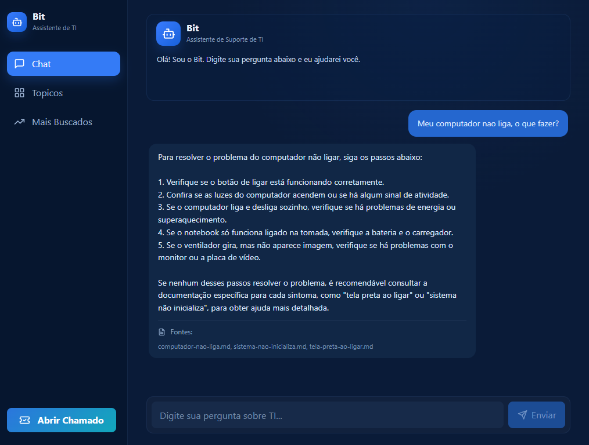

# Atualizacoes do projeto Bit

Esta versao transforma o Bit em uma central mais completa de suporte de TI.

## Abrir chamado

Na secao **Abrir Chamado**, o usuario informa:

- Nome completo
- Problema
- Descricao detalhada

Ao enviar o formulario, o sistema gera automaticamente um identificador no formato `BIT-ANO-0000` e apresenta uma confirmacao visual do chamado criado.

## Mais Buscados

A secao **Mais Buscados** apresenta um ranking ficticio dos problemas mais frequentes dos usuarios:

1. Computador nao liga
2. VPN nao conecta
3. Internet lenta
4. Impressora offline
5. Esqueci minha senha

Cada item mostra quantidade de buscas, crescimento semanal e uma solucao rapida. O botao **Resolver no chat** envia o problema diretamente para o assistente.

## Topicos de suporte

Os problemas ficam organizados em categorias:

### Redes

- Internet lenta
- VPN nao conecta
- Sem acesso ao Wi-Fi

### Hardware

- Computador nao liga
- Notebook superaquecendo
- Monitor sem sinal

### Perifericos

- Impressora offline
- Mouse nao funciona
- Teclado com falha

Cada solucao possui o botao **Falar no chat**, que abre o chatbot e envia a pergunta relacionada automaticamente.

## Interface atualizada

## Melhorias entregues

- Navegacao funcional entre Chat, Topicos, Mais Buscados e Abrir Chamado
- Formulario completo de abertura de ticket
- Identificacao numerica gerada para cada chamado
- Solucoes rapidas organizadas por area tecnica
- Integracao dos problemas encontrados com o chatbot
- Ranking ilustrativo de demanda de suporte
- Interface responsiva mantida no mesmo padrao visual do projeto
