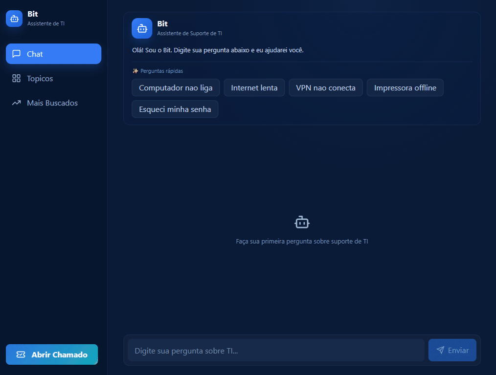
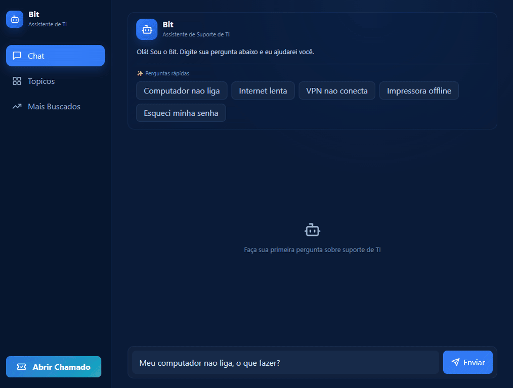
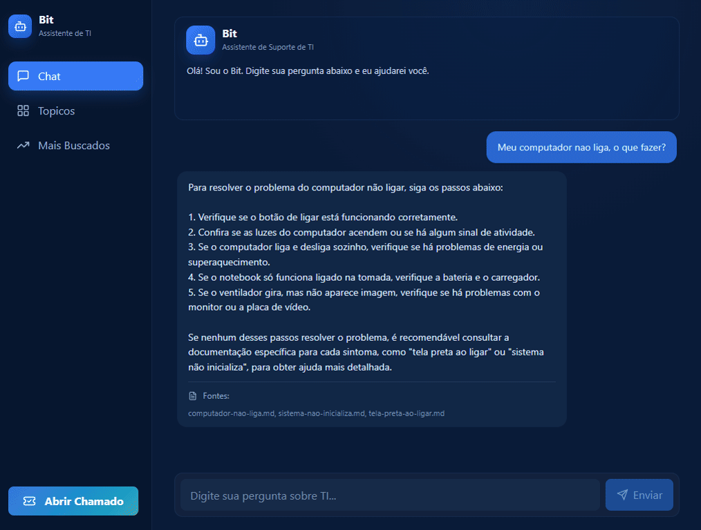

# GIFs para LinkedIn - Bit

Arquivos animados preparados para publicar o projeto **Bit - Assistente de Suporte de TI** no LinkedIn.

## Interface inicial

Apresenta o layout principal do projeto, com menu lateral, perguntas rapidas e area de conversa.

[Baixar GIF da interface inicial](./assets/linkedin-gifs/bit-interface-inicial.gif)

## Pergunta ao assistente

Demonstra a etapa em que o usuario informa um problema para o Bit.

[Baixar GIF da pergunta](./assets/linkedin-gifs/bit-pergunta.gif)

## Resposta fundamentada

Demonstra a resposta gerada pelo assistente e a exibicao das fontes consultadas.

[Baixar GIF da resposta fundamentada](./assets/linkedin-gifs/bit-resposta-fundamentada.gif)

## Sugestao de texto

O Bit e um assistente de suporte de TI desenvolvido com React, TypeScript, Python, FastAPI, ChromaDB e OpenRouter. A interface permite que o usuario descreva um problema em linguagem natural e receba orientacoes fundamentadas em uma base de conhecimento corporativa.
